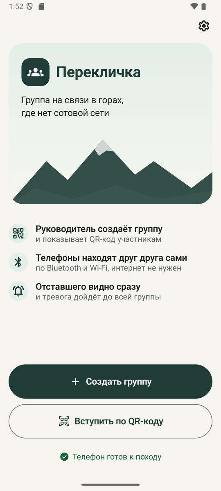
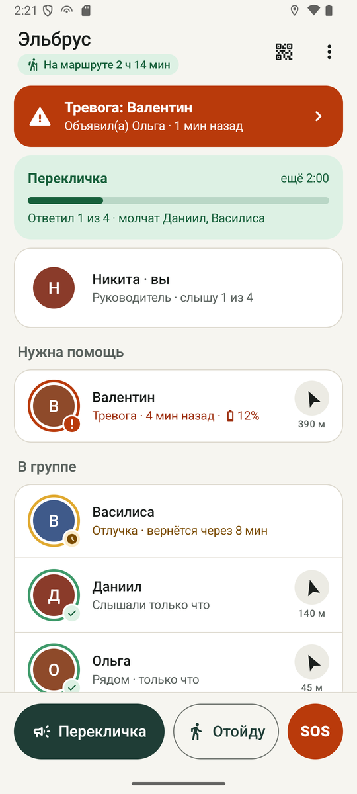
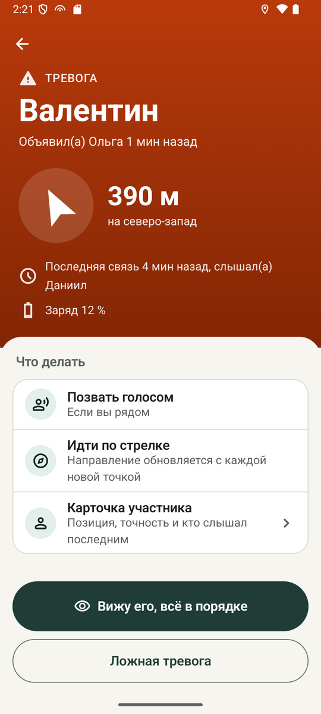
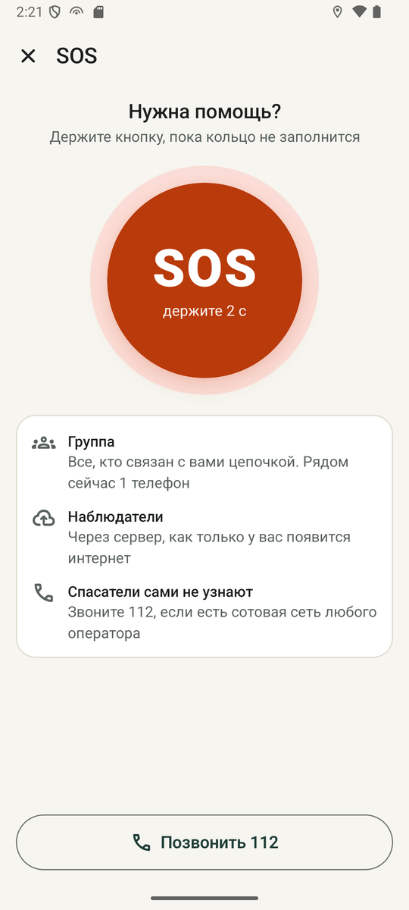

# Перекличка

Android-приложение для туристической группы в горах, где нет сотовой сети. Телефоны участников связываются друг с другом напрямую по Bluetooth и Wi-Fi, поэтому руководитель видит, кто рядом, кто отошёл и кого группа давно не слышит. Тревога и SOS доходят до всех, кто связан с отправителем цепочкой телефонов.

| Старт | Группа | Тревога | SOS |
|---|---|---|---|
|  |  |  |  |

## Что умеет

- Руководитель создаёт группу и показывает QR-код, участники сканируют его встроенным сканером. Интернет для этого не нужен.
- У каждого участника виден статус: «Норма», «Отлучка», «Не слышно», «Тревога» или SOS. Рядом показаны время последней связи, расстояние, направление стрелкой и заряд, если он низкий. «Не слышно» наступает через 2 минуты без связи, а в режиме демо через минуту.
- Руководитель запускает перекличку и видит, кто ответил, кто рядом, но молчит, и до чьего телефона перекличка уже дошла.
- Участник может отойти на 5, 10 или 20 минут, и группа не поднимет из-за него тревогу. За минуту до конца срока телефон спрашивает, вернулся ли он.
- Тревогу о пропавшем объявляет любой участник, SOS отправляется удержанием кнопки 2 секунды. Сигнал уходит соседям сразу и дальше по цепочке, а отправитель видит, какие телефоны рядом его подтвердили.
- Телефон пишет GPS-трек и, как только у кого-то в группе появляется интернет, отправляет точки всей группы на сервер, где их видно на карте. Если сеть есть, SOS тоже уходит на сервер, и тот рассылает его наблюдателям через ntfy.
- Приложение работает с выключенным экраном в кармане: обмен идёт в foreground service, которая поднимается сама после убийства процесса и после перезагрузки телефона.

SOS не вызывает экстренные службы. Сигнал получат только телефоны группы, связанные с отправителем цепочкой, и наблюдатели, если у кого-то из группы появится интернет. Доставка на каждый телефон не гарантируется.

## Обмен без интернета

Каждый телефон хранит всё, что знает о группе: события (вступил, отлучка, перекличка, тревога, SOS), последние состояния участников и точки трека. Записи каждого автора нумеруются подряд, поэтому при встрече с соседом телефоны обмениваются короткой сводкой «у меня от каждого автора всё до номера N» и досылают друг другу только недостающее. Так данные идут по цепочке, и участник, которого руководитель не слышит напрямую, всё равно виден у руководителя, если их соединяет цепочка телефонов группы, где каждый слышит следующего.

Общих часов у телефонов нет. Вместо времени создания каждая запись хранит свой возраст, и он растёт по монотонным часам телефона, поэтому «слышали 4 минуты назад» верно даже на телефоне со сбитыми часами. Статусы и тревоги считаются на каждом телефоне из одних и тех же записей, и все телефоны показывают одну картину. Подробно протокол описан в [`docs/03-sync-protocol.md`](docs/03-sync-protocol.md), контракт сервера лежит в [`docs/server/openapi.yaml`](docs/server/openapi.yaml).

## Технологии

Kotlin, Jetpack Compose и Material 3, Hilt, Room, WorkManager, Google Nearby Connections, Fused Location Provider, Retrofit с OkHttp и zxing для QR-кодов. Приложение работает на Android 8 и новее (minSdk 26, targetSdk 36).

## Сборка и тесты

Нужны Android Studio (её JDK подходит) и Android SDK с платформой 37. Путь к SDK Android Studio записывает в `local.properties` сама.

```text
./gradlew assembleDebug test      # APK и все тесты, около минуты после первой сборки
./gradlew :domain:test            # только логика без Android, несколько секунд
./gradlew :app:testDebugUnitTest  # тесты app, Room и WorkManager идут через Robolectric без эмулятора
```

Для проверки обмена нужны настоящие телефоны, потому что эмулятор соседей через Nearby не находит. Все телефоны прошивают с одного ноутбука: у каждого ноутбука свой отладочный ключ, и сборка с другим ключом поверх установленной не встанет.

HTTP-клиент можно проверить на работающем сервере:

```sh
MONITOR_LIVE_URL=https://rollcall.vareonix.cc ./gradlew :app:testDebugUnitTest --tests 'ru.pereklichka.upload.MonitorLiveApiTest' --rerun-tasks
```

Тест создаёт на этом сервере новую группу с двумя точками и ключом просмотра. Данные остаются на сервере после проверки, а тестовый ключ нигде не сохраняется. Без `MONITOR_LIVE_URL` тест пропускается.

## Модули

`domain` написан на чистом Kotlin и про Android не знает, поэтому всё в нём проверяется на ноутбуке за секунды.

| Пакет | Что внутри |
|---|---|
| `domain/model` | Записи группы: события, точки трека, состояния участников, группа, QR |
| `domain/time` | Часы и отметка свежести: возраст записи без общих часов |
| `domain/sync` | Сообщения Hello и Delta, кодек, контракты `MeshStore` и `PeerTransport`, движок `SyncEngine` |
| `domain/presence` | `PresenceTracker`: кого телефон слышит напрямую |
| `domain/rules` | `GroupCalculator` и `GroupView`: статусы, тревоги, перекличка, расстояния |
| `domain/track` | Прореживание трека и очистка фиксаций |
| `domain/testing` | `InMemoryMeshStore` и `FakeClock` для тестов обоих модулей, `InMemoryNetwork` с `InMemoryTransport` для симуляции в `domain`. Пакет лежит в `testFixtures` и в APK не попадает |

`app` содержит всё, что требует Android.

| Пакет | Что внутри |
|---|---|
| `di` | Модули Hilt и переключатель фейковых данных `DataModeModule` |
| `data`, `data/db` | Room, `RoomMeshStore`, `GroupRepository`, `AppSettings`, токен группы |
| `actions` | `GroupActions`: действия человека превращаются в события |
| `status` | `GroupViewProvider` (единственный источник `GroupView`) и `StatusMonitor` (уведомления) |
| `service` | `RouteService`, GPS, своё состояние, wake lock и исключение из оптимизации |
| `transport` | Nearby, политика соединений, проверка радио |
| `notify` | Контракт уведомлений, `AndroidNotifier` и приёмники действий с уведомлениями |
| `upload` | DTO по `openapi.yaml`, `EventsApi`, `UploadScheduler`, `UploadWorker`, `SosWorker` |
| `qr` | Формат и разбор QR, картинка кода |
| `permissions` | Списки разрешений по версиям Android и экран запроса |
| `ui` | Тема, навигация, экраны, `GroupViewModel`, `FakeGroupViews`, настройки и экран «Для разработчиков» |

## Команда

| Кто | Чем занимался |
|---|---|
| Никита | Техлид: архитектура, правила статусов и тревог, уведомления, QR, общая сборка |
| Ольга | Движок синхронизации и транспорт на Nearby Connections |
| Василиса | Хранилище на Room, GPS, фоновая служба и её перезапуск, экран разрешений |
| Валентин | Экраны приложения и уведомления о тревогах |
| Даниил | Сервер, карта и отправка точек и SOS с телефона |

Задачи, которые команда ставила себе на время разработки, лежат в [`docs/team`](docs/team).
